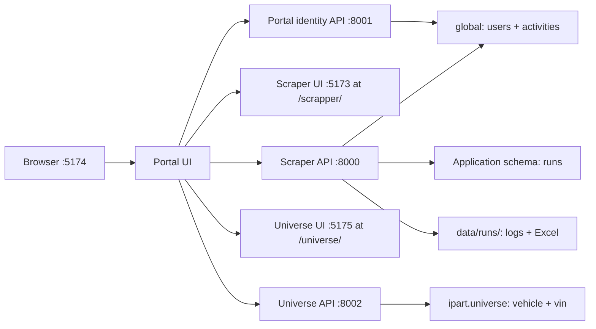

# Portal Apps

Portal Apps is the shared platform entry point for the applications in this
folder. It provides one login and account directory for connected apps. The
Scraper CMS is mounted at `/scrapper/`; Universe Master Data is mounted at
`/universe/`.

## System Overview

| Service | Port | Owns |
|---|---:|---|
| Portal UI | 5174 | Login screen, app launcher, profile, account administration |
| Portal identity API | 8001 | Shared login/logout, users, profile, shared activity |
| Scraper UI | 5173 | Crawler dashboard, run details, logs, downloads |
| Scraper API | 8000 | Crawler operations, runs, run artifacts, scraper activity writes |
| Universe UI | 5175 | Vehicle and VIN master data |
| Universe API | 8002 | Vehicle/VIN CRUD, filtering, Excel import/export |

The portal Vite server proxies identity endpoints to the Portal API, crawler
and run endpoints to the Scraper API, and `/scrapper/` to the Scraper UI. It
also proxies `/universe/` and `/api/universe` to Universe. The browser uses one
origin, so the HTTP-only `portal_session` cookie is shared across applications.



## Shared Identity

Portal Apps owns the user credentials. The Portal API checks credentials,
issues the HTTP-only session cookie, manages accounts and profiles, and writes
shared identity activity. Connected applications validate the same JWT cookie
using the same signing secret; they do not keep separate user credentials.

On PostgreSQL, the shared `users` and `activities` tables are in schema
`global`. Scraper run records remain in the configured application schema and
refer to the shared user IDs. Existing identity tables are moved from the old
application schema at Scraper API startup when the `global` tables are absent.

Both APIs read their database URL, database schema, JWT secret, and cookie
security setting from `scrapper-site/backend/.env`. Set `cookie_secure=true`
when using HTTPS, including ngrok; use `false` for local HTTP development. On
first Portal API startup, `superadmin` / `12345678` is created only if no user
exists. Change that password before real use.

Universe domain records use PostgreSQL database `ipart`, schema `universe`,
with `vehicle` and `vin` tables. VIN rows reference vehicles through
`id_vehicle`; this schema is separate from `global` identity and scraper runs.

## Start Locally

To start all six services in separate PowerShell windows, run:

```powershell
cd C:\ELFANI\portal-apps
.\start_all.ps1
```

To stop the launched services and any listeners on their app ports, run:

```powershell
cd C:\ELFANI\portal-apps
.\stop_all.ps1
```

The stop script targets ports 8000-8002 and 5173-5175. Services can also be
started individually in separate PowerShell terminals:

```powershell
# Portal identity API
cd C:\ELFANI\portal-apps
.\run_portal_api.ps1

# Scraper API
cd C:\ELFANI\portal-apps\scrapper-site\backend
.\.venv\Scripts\python.exe -m uvicorn app.main:app --host 127.0.0.1 --port 8000

# Scraper UI
cd C:\ELFANI\portal-apps\scrapper-site
.\run_ui.ps1

# Portal UI
cd C:\ELFANI\portal-apps
.\run_portal.ps1

# Universe API
cd C:\ELFANI\portal-apps
.\run_universe_api.ps1

# Universe UI
cd C:\ELFANI\portal-apps
.\run_universe_ui.ps1
```

Open http://localhost:5174. The Portal API launcher creates its Python virtual
environment and installs its requirements on first use. The UI launchers
install frontend packages when needed.

For HTTPS access, tunnel the portal only:

```powershell
ngrok http 5174
```

Update `portal-site/vite.config.ts` allowed hosts if the ngrok hostname changes.
Crawler browser windows still open on the machine running the Scraper API.

## Site Guides

- [Portal UI and identity API](portal-site/README.md)
- [Scraper CMS and crawler operations](scrapper-site/README.md)
- [Universe master data](universe-site/README.md)