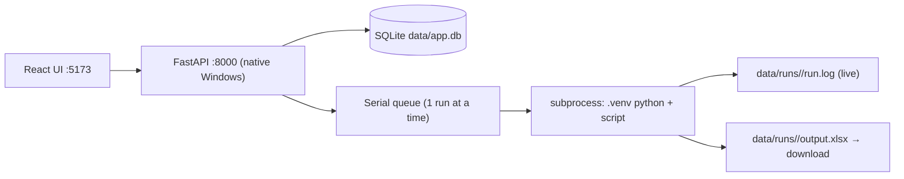

# Scraper CMS

Web UI to run the existing crawler scripts — upload an Excel file, queue a run,
watch the log live, download the result. The crawlers themselves are **not**
modified; the CMS just launches them as subprocesses with their own virtualenvs,
exactly like running them by hand.

## Covered crawlers

| Group | Crawlers | Project folder |
|---|---|---|
| CCC | Workfile (VIN) | `C:\ELFANI\scrapper-ccc` |
| Keystone | Partslink, Find-Model | `C:\ELFANI\scrapper-keystone` |
| CARiD | Parts, Interchange | `C:\ELFANI\scrapper` |
| Brands (OEM Parts) | Acura, Audi, BMW, Chrysler, Ford, GMC, Honda, Hyundai, Infiniti, Kia, Lexus, Mazda, Nissan, Porsche, Subaru, Toyota, Volvo, VW | `C:\ELFANI\scrapper-brand\scrapper-*` |

Crawler definitions live in [backend/app/crawlers.py](backend/app/crawlers.py).
Adding another script = one entry in that file.

## Cloudflare / human verification

Runs execute **one at a time** (serial queue) so Chrome profiles and CDP ports
never collide. CARiD and brand crawlers open a visible Chrome window; when a
Cloudflare check appears, the run is flagged **"waiting for human verification"**
in the UI — open the Chrome window, click the checkbox, and the run continues
by itself. The persistent Chrome profiles keep the clearance cookie, so this
usually happens rarely.

## Run it

Two terminals (or run both scripts in background):

```powershell
.\run_api.ps1   # backend  → http://127.0.0.1:8000  (creates its own .venv)
.\run_ui.ps1    # frontend → http://localhost:5173
```

Then open http://localhost:5173.

## How it works



- Uploads and outputs are stored per run under `data/runs/<id>/`.
- The runner scans log output for Cloudflare markers to set the
  "waiting for human" flag.
- Stop kills the whole process tree (`taskkill /T`), including the Chrome
  instance the script spawned.

## API quick reference

| Endpoint | Purpose |
|---|---|
| `GET /api/crawlers` | List registered crawlers + capabilities |
| `POST /api/runs` | multipart: `crawler_id`, `file`, `column`, `limit`, `fresh`, `show`, `debug`, `manual_login` |
| `GET /api/runs` / `GET /api/runs/{id}` | List / inspect runs |
| `GET /api/runs/{id}/log?tail=300` | Tail of the live log |
| `POST /api/runs/{id}/stop` | Kill the run's process tree |
| `GET /api/runs/{id}/output` | Download the result Excel |
| `GET /api/queue` | Queue status |
