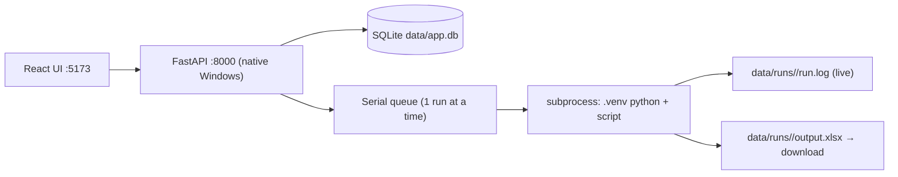

# Scraper CMS

Web UI to run the existing crawler scripts — upload an Excel file, queue a run,
watch the log live, download the result. The crawlers themselves are **not**
modified; the CMS just launches them as subprocesses with their own virtualenvs,
exactly like running them by hand.

## Covered crawlers

| Group | Crawlers | Project folder |
|---|---|---|
| CCC | Workfile (VIN; configurable description match, defaults to `A/M: CAPA`) | `C:\ELFANI\scrapper-ccc` |
| Keystone | Partslink, Find-Model | `C:\ELFANI\scrapper-keystone` |
| CARiD | Parts, Interchange | `C:\ELFANI\scrapper` |
| Brands (OEM Parts) | Acura, Audi, BMW, Chrysler, Ford, GMC, Honda, Hyundai, Infiniti, Kia, Lexus, Mazda, Nissan, Porsche, Subaru, Toyota, Volvo, VW | `C:\ELFANI\scrapper-brand\scrapper-*` |

Crawler definitions live in [backend/app/crawlers.py](backend/app/crawlers.py).
Adding another script = one entry in that file.

## Cloudflare / human verification

Runs execute **one at a time** (serial queue) so Chrome profiles and CDP ports
never collide. CARiD and brand crawlers open a visible Chrome window; when a
Cloudflare check appears, the run is flagged **"waiting for human verification"**
in the UI — open the Chrome window, click the checkbox, and the run continues
by itself. The persistent Chrome profiles keep the clearance cookie, so this
usually happens rarely.

## Run it

Two terminals, one for each server. Order doesn't matter, but both must be up.

```powershell
# Terminal 1 — backend (API on :8000)
cd C:\ELFANI\scrapper-site\backend
.\.venv\Scripts\python.exe -m uvicorn app.main:app --host 127.0.0.1 --port 8000

# Terminal 2 — frontend (UI on :5173)
cd C:\ELFANI\scrapper-site
.\run_ui.ps1
```

Then open http://localhost:5173 (or your ngrok URL).

> First run only: `run_api.ps1`/`run_ui.ps1` create the backend venv and install
> frontend deps automatically. If PowerShell blocks a script with
> **UnauthorizedAccess**, run it once with:
> `powershell -ExecutionPolicy Bypass -File .\run_ui.ps1`
> (or permanently allow local scripts: `Set-ExecutionPolicy -Scope CurrentUser RemoteSigned`)

### Backend — when to restart

The API has **no auto-reload**. Restart it after changing any file in
`backend/app/` (`crawlers.py`, `runs.py`, …) or `backend/.env`:

```powershell
# in the backend terminal: Ctrl+C, then
.\.venv\Scripts\python.exe -m uvicorn app.main:app --host 127.0.0.1 --port 8000
```

While actively developing the backend, add `--reload` to restart on save
(remove it in normal use — it kills an in-progress crawl when a file changes):

```powershell
.\.venv\Scripts\python.exe -m uvicorn app.main:app --reload --host 127.0.0.1 --port 8000
```

> Note: restarting the API marks any `running`/`queued` run as failed, and
> re-seeds the `superadmin` account if it was deleted.
> If you get `No module named 'uvicorn'`, you're in the wrong folder —
> `cd C:\ELFANI\scrapper-site\backend` first (the venv lives in `backend\.venv`).

### Frontend — usually no restart

Vite hot-reloads on save — just refresh the browser. Restart `run_ui.ps1` only
after changing `vite.config.ts` or `package.json`.

### Crawler scripts — no CMS restart

Each run launches the crawler as a fresh subprocess, so edits to scripts in
`C:\ELFANI\scrapper-*` apply on the **next queued run** (a running crawl keeps
the old code).

### "Port 5173 is in use" / ngrok shows the old UI

A stale dev server is holding the port. Kill it and rerun `run_ui.ps1`:

```powershell
netstat -ano | findstr :5173          # note the PID in the last column
Stop-Process -Id <PID> -Force
.\run_ui.ps1
```

### Backend "error while attempting to bind on address ('127.0.0.1', 8000)"

Same thing, one port down — a previous uvicorn is still holding :8000. Free it
and re-run:

```powershell
netstat -ano | findstr :8000          # note the PID
Stop-Process -Id <PID> -Force
.\.venv\Scripts\python.exe -m uvicorn app.main:app --host 127.0.0.1 --port 8000
```

## ngrok

One tunnel to the frontend is enough — the UI calls same-origin `/api`, and
Vite proxies it to the backend:

```powershell
ngrok http 5173
```

If the tunnel URL changes, update it in two places:

- `frontend/vite.config.ts` → `server.allowedHosts`
- `backend/.env` → `cors_origins`

Remote visitors can queue and watch runs, but the browser windows (and any
Cloudflare human check) always open on **this** machine.

## How it works



- Uploads and outputs are stored per run under `data/runs/<id>/`.
- The runner scans log output for Cloudflare markers to set the
  "waiting for human" flag.
- Stop kills the whole process tree (`taskkill /T`), including the Chrome
  instance the script spawned.

## Accounts

Sign in at `/login`. On first start the backend creates a default superadmin:
`superadmin` / `12345678` — **change this password** (Accounts page) before real
use. Menus: **Crawling** (run dashboard), **Activity** (per-user history;
superadmin sees everyone), **Accounts** (superadmin-only user CRUD +
activate/deactivate).

## API quick reference

All endpoints except `/api/auth/login` require an `Authorization: Bearer <token>` header.

| Endpoint | Purpose |
|---|---|
| `POST /api/auth/login` | Log in, returns JWT + user |
| `GET /api/auth/me` | Current user |
| `GET /api/crawlers` | List registered crawlers + sites + capabilities |
| `POST /api/runs` | multipart: `crawler_id`, `file`, `column`, `site`, `description` (CCC), `limit`, `fresh`, `show`, `debug`, `manual_login` |
| `GET /api/runs` / `GET /api/runs/{id}` | List / inspect runs |
| `GET /api/runs/{id}/log?tail=300` | Tail of the live log |
| `POST /api/runs/{id}/stop` | Kill the run's process tree |
| `GET /api/runs/{id}/output` | Download the result Excel |
| `GET /api/queue` | Queue status |
| `GET /api/activity?q=&username=` | Activity history (users see own; superadmin all) |
| `GET/POST /api/users`, `PUT/DELETE /api/users/{id}` | User CRUD (superadmin only) |
